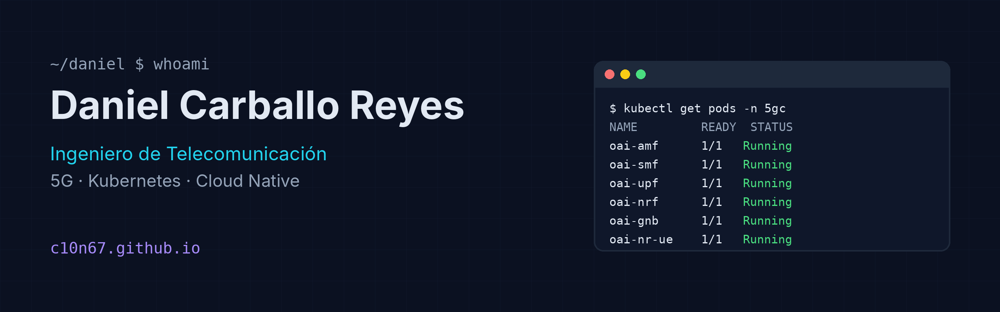

<a href="https://c10n67.github.io">
  
</a>

<p align="center">
  <a href="https://c10n67.github.io"></a>
  <a href="https://www.linkedin.com/in/danielcarballoreyes/"></a>
  <a href="mailto:dani.carballoreyes@gmail.com"></a>
  <a href="https://c10n67.github.io/files/CV_Daniel_Carballo.pdf"></a>
</p>

```console
~/daniel $ whoami
Daniel Carballo Reyes · Ingeniero en Tecnologías de Telecomunicación (UC3M)
📍 Boadilla del Monte, Madrid
```

## 👋 Sobre mí

Soy ingeniero de telecomunicaciones recién graduado por la **Universidad Carlos III de Madrid**, con experiencia dando soporte a **redes 5G desplegadas como CNFs sobre Kubernetes**. Me apasionan la virtualización, las redes y todo lo *cloud native*.

- 📡 He trabajado en el soporte a la red 5G de **VMO2** en Datatronics (Kubernetes sobre RHEL, Helm, kubeadm).
- 🎓 Mi TFG: un **núcleo 5G SA completo de OpenAirInterface orquestado en Kubernetes**.
- 🏠 Mantengo mi propio clúster en un **homelab** (Proxmox + Raspberry Pi).
- 📚 Ahora mismo preparo la **CKA** (Certified Kubernetes Administrator) y el **C1 de inglés**.
- 💬 ¿Buscas a alguien para 5G, Kubernetes o infraestructura cloud native? [Hablemos](mailto:dani.carballoreyes@gmail.com).

## 🚀 Proyectos destacados

### 📶 [Núcleo 5G como CNFs en Kubernetes](https://c10n67.github.io/tfg.html) · TFG 2026

Red **5G Standalone** completa (5GC + RAN) de OpenAirInterface sobre Kubernetes: núcleo desplegado con **Helm**, interfaces **N2/N3/N4/N6** separadas con **Multus + macvlan** siguiendo el modelo del 3GPP, y gNB + UE conectados por *rfsimulator*.

| 8 | 4 | 7 | 0 % |
|:---:|:---:|:---:|:---:|
| pods del 5GC en *Running* y registrados en el NRF | interfaces 3GPP con Multus | incidencias diagnosticadas hasta la causa raíz | pérdida en el ping UE → Internet |

`OpenAirInterface` `Kubernetes` `Helm` `Multus` `NGAP` `GTP-U` `PFCP` `Prometheus` `Grafana` · [📄 Memoria (PDF)](https://c10n67.github.io/files/TFG_Daniel_Carballo_Reyes.pdf)

### 🌌 [Homelab Polaris](https://c10n67.github.io/homelab.html) · Kubernetes en casa

Un portátil reciclado con **Proxmox VE** dividido en dos nodos Debian, *OsaMayor* y *OsaMenor*, más *Orion*, una **Raspberry Pi 4** como tercer nodo (arm64). Clúster montado a mano con **kubeadm** y **Calico** como CNI, con **Prometheus + Grafana** para la observabilidad. Mi laboratorio para preparar la CKA.

```console
$ kubectl get nodes
NAME       STATUS   ROLES           ARCH
osamayor   Ready    control-plane   amd64
osamenor   Ready    <none>          amd64
orion      Ready    <none>          arm64
```

### 🎲 [MESA](https://github.com/C10N67/MESA)

Mapa interactivo de D&D para jugar online o en local, con vista de máster y de jugadores. Un proyecto personal.

## 🛠️ Tecnologías

**5G / Telecom**


**Cloud native**


**Sistemas y redes**


**Programación**


## 🎓 Formación y certificaciones

- **Grado en Ingeniería de Tecnologías de Telecomunicación** · Universidad Carlos III de Madrid (2020 – 2026)
- **CKA · Certified Kubernetes Administrator** · en preparación
- **Inglés**: Cambridge B2 First · preparando el C1

<details>
<summary>🇬🇧 <b>English version</b></summary>

<br>

I'm a recently graduated **telecommunications engineer** from Universidad Carlos III de Madrid, with hands-on experience supporting **5G networks running as CNFs on Kubernetes**. I'm passionate about virtualization, networking and everything cloud native.

- 📡 Supported **VMO2's 5G network** at Datatronics (Kubernetes on RHEL, Helm, kubeadm).
- 🎓 Bachelor's thesis: a **complete OpenAirInterface 5G SA network orchestrated on Kubernetes**, with 3GPP interfaces split out using Multus and a UE carrying real end-to-end traffic. [Read the case study](https://c10n67.github.io/tfg.html).
- 🏠 I run my own **homelab** Kubernetes cluster (Proxmox + Raspberry Pi, kubeadm, Calico, Prometheus + Grafana). [Explore it](https://c10n67.github.io/homelab.html).
- 📚 Currently preparing for the **CKA** and the **C1** English certificate.
- 💬 Looking for someone to work on 5G, Kubernetes or cloud native infrastructure? [Let's talk](mailto:dani.carballoreyes@gmail.com).

</details>

<p align="center"><sub><code>kubectl get pods -n 5gc · Running</code></sub></p>
